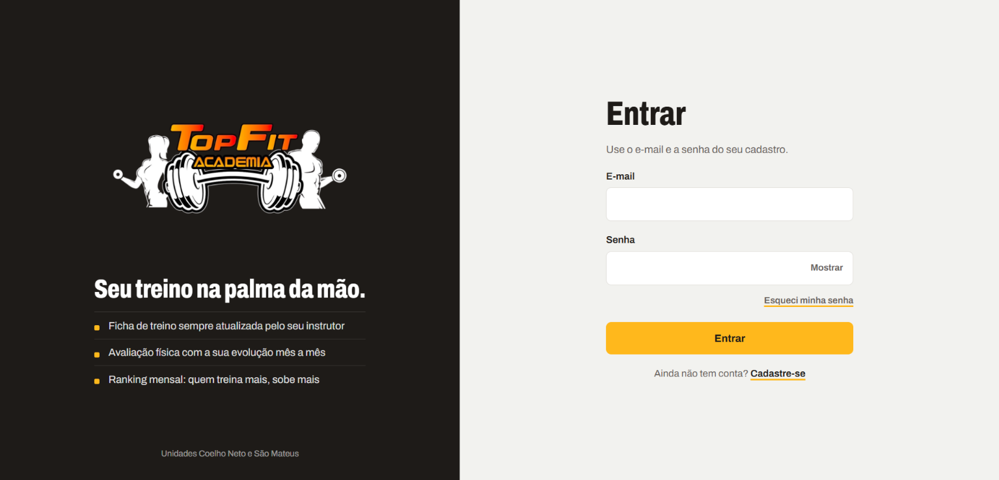
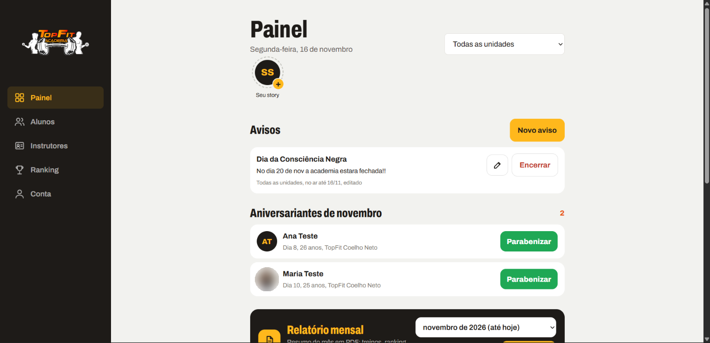
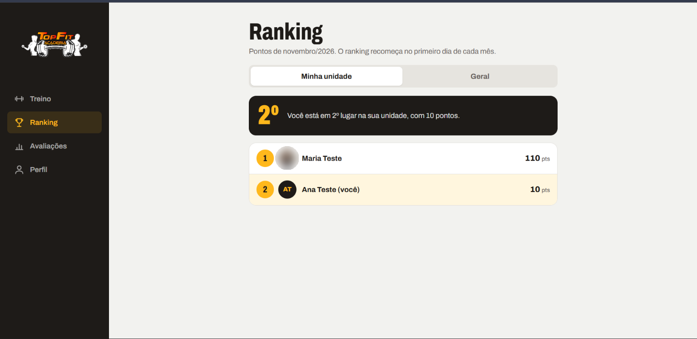
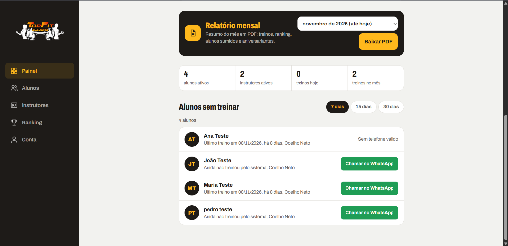
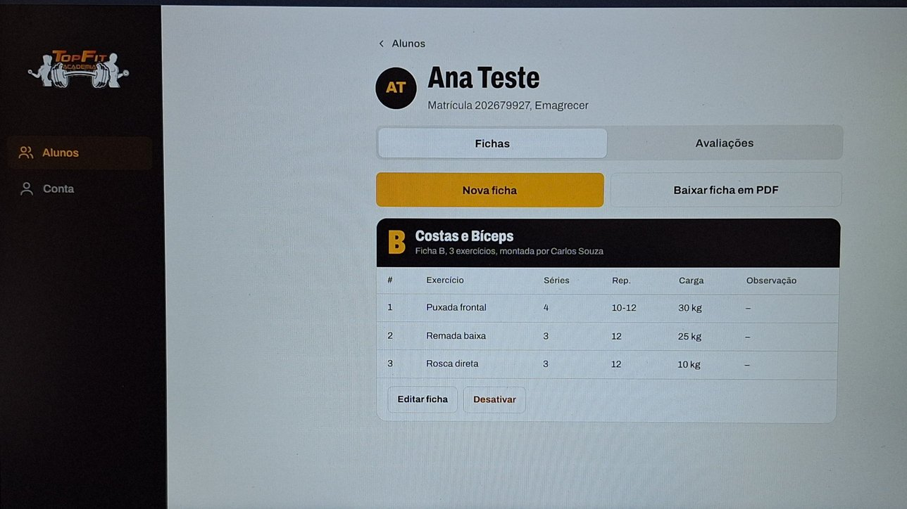

# 🏋️ Sistema de Gestão e Gamificação para Academia

Sistema web que desenvolvi de forma independente, para uma academia com duas unidades no Maranhão (Coelho Neto e São Mateus).

>  O código-fonte é privado, pois o sistema está sendo oferecido comercialmente. Este repositório é uma vitrine do projeto. As telas usam apenas dados de teste.

##  O problema
Muitos alunos desistem da academia nos primeiros meses. O dono também precisava de mais organização para acompanhar alunos e instrutores.

## A solução
- 🏆 **Ranking mensal** com pontos por treino concluído (por unidade e geral)
- 🔥 **Ofensiva semanal** para incentivar a constância
- 📍 **Check-in por localização**, que confirma que o aluno está na academia
- 🔔 **Notificações** motivacionais
- 📏 **Avaliação física (antropométrica)** com histórico de evolução
- 📋 **Fichas de treino** montadas pelo instrutor, com download em PDF
- 📄 **Relatório mensal em PDF** e lista de **alunos sem treinar**, com atalho para o WhatsApp
- 🎂 **Aniversariantes do mês**
- 👥 Perfis: **dono**, **instrutor** e **aluno**

## Telas

**Login**

**Painel do dono: avisos e aniversariantes**

**Ranking mensal (visão do aluno)**

**Relatório mensal e alunos sem treinar**

**Ficha de treino (visão do instrutor)**

 [Ver todas as telas em PDF](telas-sistema-academia.pdf)

## Tecnologias
HTML · CSS · JavaScript · Java · Spring Boot · PostgreSQL
